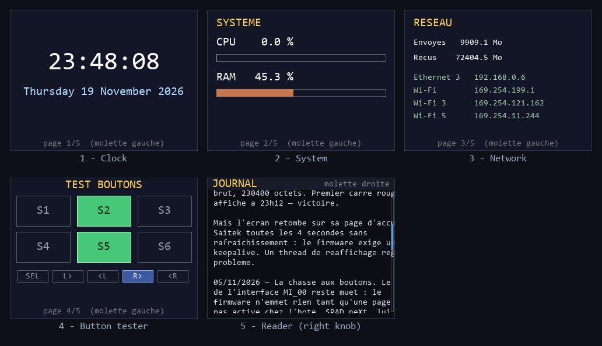

# FIPunlocked


**Turn a dusty Saitek/Logitech Flight Instrument Panel into a generic 320×240
display with 6 working buttons and 2 rotary knobs — driven over HTTP.**


The Flight Instrument Panel (FIP, `VID_06A3 PID_A2AE`) was designed for flight
sims only. This project unlocks it as a **mini second screen + Stream-Deck-style
controller** for anything: system dashboard, news reader, custom pages, or plain
`POST /screen` with any image.

## ✨ Features

- 🖥️ **320×240 display** — push any PNG/JPG/BMP/WEBP, a URL, or a video file
- 🔘 **6 side buttons + 2 knobs** — live feedback, edge detection (press/release)
- 📑 **5 built-in pages** (left knob cycles) — see below
- ⌨️ **Opt-in keyboard bindings** — map `ctrl+shift+s`, `volumemute`, `win+d`…
  on any control. *Default: controls act only on the FIP's own pages, nothing
  runs on the host.*
- 🌐 **HTTP API + SSE** on `:8199` — trivially scriptable from any language
- 🚫 **No SPAD.neXt, no licence, no subscription** — only the free official
  Logitech driver stack

## 🚀 Quickstart

```bash
# once, as admin: the official Logitech service (auto-start is set during install)
sc start DirectOutputService

pip install pillow psutil opencv-python   # opencv only for /video
cd fipd
python fipd3.py                            # -> http://127.0.0.1:8199
```

## 📑 The five built-in pages



| Page | Content |
|---|---|
| **1 · Clock** | Big clock + date |
| **2 · System** | CPU / RAM / disk bars, live |
| **3 · Network** | Traffic counters + interface IPs |
| **4 · Button tester** | S1–S6 light up on press, knobs & select states — instant feedback |
| **5 · Reader** | Long text scrolled by the **right knob** (44 px/notch) with progress bar |

Left knob = previous/next page. The reader scrolls only when the right knob has
no binding configured.

## ⌨️ Keyboard bindings (Stream-Deck mode, opt-in)

Edit `fipd/fipd_bindings.json` (hot-reloaded) or:

```bash
curl -X POST -d '{"paging": true,
  "bindings": {"S1": "ctrl+shift+s", "S2": "volumemute"},
  "pages": {"1": {"S3": "f5"}}}' http://127.0.0.1:8199/bindings
```

- Controls: `S1..S6`, `select`, `left_cw/left_ccw`, `right_cw/right_ccw`
- 102 key names (`GET /keys`): letters, F-keys, modifiers, nav, media keys…
- Hold-aware: keys go down on press, up on release; knobs pulse per notch
- `pages` overrides per FIP page · `"paging": false` frees the left knob
- Native `SendInput` (scancodes) — no extra dependency

## 🔌 HTTP API

| Endpoint | Effect |
|---|---|
| `POST /screen` (body = image, or `?url=...`) | Display an image |
| `POST /video` (body = video file) | Play it (S1 = stop) |
| `POST /ui` | Back to the built-in pages |
| `GET /buttons` | SSE stream of button/knob events |
| `GET /events` | Last 50 events (JSON) |
| `GET/POST /bindings` | Read / update keyboard bindings |
| `GET /keys` | Recognized key names |
| `GET /` | Status page |

## 🔬 How it works (the fun part)

The stock Logitech stack is: **`DirectOutput.dll`** — a named-pipes *client*
library apps link against — talking to **`DirectOutputService.exe`**, a SYSTEM
service hosting `DirectOutputSaiFip.dll` (the real device plugin).
`DirectOutput_Initialize` **blocks forever** when the service isn't running:
that's the trap everyone falls into. `fipd3.py` drives that stack from Python:

```
Initialize → Enumerate → RegisterSoftButtonCallback → AddPage(0, FLAG_SET_AS_ACTIVE)
→ SetImage (+ keepalive every 2 s)
```

Firmware quirks discovered along the way: HID reports only flow while a page is
**active** and images keep coming (the panel falls back to its home screen after
~2–3 s idle), and a clean service shutdown closes the session (USB power-cycle
resets it).

Everything was reverse-engineered from scratch — disassembly of the plugin DLL
(capstone/pefile, `disas_*.py`), IL dumps of the client libraries (Mono.Cecil,
`cecil/`), Frida captures, and a **proxy DLL** (`proxy/`) swapped in front of the
real plugin inside the service to log its exact init sequence. The full story
lives in [`fipd/README.md`](fipd/README.md) (French); reference wire captures in
`fipd/startserver_session.log` and `fipd/proxy_log_copie.txt`.

## 🗺️ Roadmap

- [ ] Capture the exact wire bytes of the page-activation sequence → pure-Python
      `firmware_init()` (drop the Logitech stack entirely)
- [ ] **Linux port** — libusb for the bulk interface (44-byte big-endian header
      protocol, already decoded in `fip.py`) + hidraw for buttons
- [ ] LED support (hardware-dependent: ACK'd but seemingly not wired on the A2AE)

## 📁 Layout

- [`fipd/`](fipd) — the HTTP daemon (`fipd3.py`) + pure-Python protocol driver
  (`fip.py`) + test clients, Frida captures, `gen_screens.py` (doc screenshots)
- [`proxy/`](proxy) — gcc source of the x64 proxy DLL + deploy/restore script
- [`disas_*.py`](.) — targeted disassembly tooling
- [`cecil/`](cecil) — Mono.Cecil IL dump scripts
- [`docs/`](docs) — screenshots (exact renders of what the daemon sends)

## ⚠️ Notes

- Windows only for now (Linux port on the roadmap)
- `SendInput` bindings don't reach elevated windows unless the daemon runs elevated
- Button masks (HID `mi_00`, hardware-confirmed): `S1..S6 = 0x20..0x400`,
  `select = 0x01`, right knob CW/CCW `0x02/0x04`, left knob CW/CCW `0x10/0x08`
