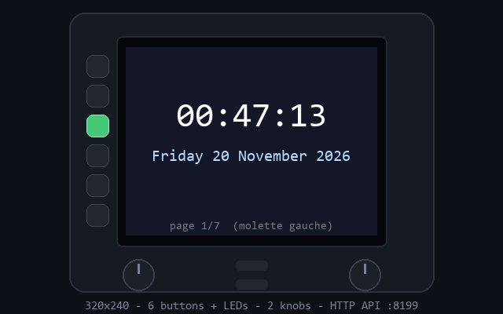

# FIPunlocked


**Turn a dusty Saitek/Logitech Flight Instrument Panel into a generic 320×240
display with 6 working buttons and 2 rotary knobs — driven over HTTP.**



The Flight Instrument Panel (FIP, `VID_06A3 PID_A2AE`) was designed for flight
sims only. This project unlocks it as a **mini second screen + Stream-Deck-style
controller** for anything: system dashboard, context-aware page for the window
you work in, news reader, custom pages, or plain `POST /screen` with any image.

## ✨ Features

- 🖥️ **320×240 display** — push any PNG/JPG/BMP/WEBP, a URL, or a video file
- 🔘 **6 side buttons + 2 knobs** — live feedback, edge detection (press/release)
- 💡 **8 LEDs** — one per side button (lights on press, like a Stream Deck) plus
  two extra LEDs, all individually controllable
- 🧩 **FIP-native apps** (`fipui.py`) — each page is an app combining rendering,
  button/knob events, persistent LEDs, visual alerts and **page-scoped
  background polls** (nothing runs while the page is not displayed)
- 📂 **Hot-loaded apps** — drop a `fipui.App` in `fipd/apps/`: it becomes a page
  at startup, and `POST /apps/reload` rebuilds **only the files you changed**
  (the other apps keep their state)
- 🎨 **Shared design system** (`charte.py`) — GitHub-Dark palette, rounded
  cards, button keycaps aligned with the physical buttons, vector icons
- 🔖 **Contextual page (CONTEXTE)** — the panel adapts to the **active window**:
  a GitHub repo/PR/issue tab becomes a live card, YouTube/Gmail/HuggingFace/
  Wikipedia/Google Search/AI chats get their own, Search Console and EdiSEO
  dashboards are **read on the screen** (UI Automation), Explorer/VS Code/
  terminal/VLC get contextual actions; any other window gets window actions
  (always-on-top, kill, restart, copy exe path…)
- 🪟 **Windows page (FENETRES)** — every open window and every Chrome/Edge tab
  on the panel, with contextual actions (no browser extension needed)
- 🎮 **DOOM on the FIP** — a from-scratch raycasting engine (160 rays, textured
  walls, sprite billboard clipping, shotgun, imps & demons, medikits, waves):
  left knob turns, right knob steps forward/back, S1 fires, S2/S3 strafe,
  S6 autorun; LEDs 1–6 mirror health
- 📑 **15 pages** (6 built-in + 9 apps) — left knob cycles, see below
- 🩹 **Self-healing** — firmware quirks are detected and repaired, and a lost
  session (service stopped or restarted, panel replugged) is rebuilt without
  restarting the daemon — **validated on the real panel: back in ~6 s after a
  service restart**
- ⌨️ **Opt-in keyboard bindings** — map `ctrl+shift+s`, `volumemute`, `win+d`…
  on any control, **whatever the keyboard layout** (AZERTY, QWERTY…). *Default:
  controls act only on the FIP's own pages, nothing runs on the host.*
- 🌐 **HTTP API + SSE** on `:8199` — trivially scriptable, and **strictly
  local** (requests from a web page are refused)
- 🚫 **No SPAD.neXt, no licence, no subscription** — only the free official
  Logitech driver stack
- ✅ **Tested** — a unit-test suite that runs without the panel (the Logitech DLL is
  simulated), on every push

## 🚀 Quickstart

```bash
# once, as admin: the official Logitech service (auto-start is set during install)
sc start DirectOutputService

pip install -r requirements.txt     # pillow, psutil, requests, uiautomation
# optional, for specific features:
pip install opencv-python            # POST /video, CAMERAS, video from Explorer
pip install winrt-Windows.Media.Control   # LECTURE (Now Playing)
# gh (GitHub CLI) for the GitHub features · ffplay (ffmpeg) for RADIO

cd fipd
python fipd3.py                      # -> http://127.0.0.1:8199
```

If the service is not running, `fipd3` says so and exits instead of hanging
(`DirectOutput_Initialize` blocks forever in that case). If the panel is not
plugged yet, the daemon starts anyway and connects when it appears.

## 📑 The six built-in pages

 *(6 core pages + 3 app highlights — the `apps/`
directory holds 9 more)*

| Page | Content |
|---|---|
| **1 · Clock** | Big clock + date |
| **2 · System** | CPU / RAM / disk bars, live |
| **3 · Network** | Traffic counters + interface IPs |
| **4 · Button tester** | S1–S6 light up on press, knobs — instant feedback |
| **5 · Reader** | Long text scrolled by the **right knob** (44 px/notch) with progress bar |
| **6 · fipui demo** | Scrollable menu (8 items, 6 visible × 40 px aligned with the buttons): right knob scrolls, S1–S6 and LEDs act on the **visible** rows, action items fire alerts |

Navigation is **bounded** (no wrap-around) and works from BOTH the left knob and
the two page buttons between the knobs (firmware-driven, via a `PageChange`
callback — with our pages registered they cycle *our* pages instead of the
stock Saitek screens). The reader scrolls only when the right knob has no
binding configured.

## 🧩 The nine hot-loaded apps (`fipd/apps/`)

| App | What it does |
|---|---|
| **DOOM** | Raycasting FPS written from scratch: 160 rays, distance/side shading + brick joints, billboard sprites clipped against the z-buffer, shotgun with muzzle flash & recoil, pain flash, pixel-art HUD face, medikits/ammo pickups, endless waves. Left knob turns, right knob steps forward/back, S1 fires, S2/S3 strafe, S6 toggles autorun, LEDs 1–6 = health |
| **CONTEXTE** | Chameleon page following the **active window**, one card per context: GitHub repo (avatar, stars/issues/PR pills, run dots, open PR; S1–S6 = Issues/PRs/Actions/Repo/copy URL/copy clone cmd), GitHub PR/issue, YouTube, Gmail (unread badge), HuggingFace model, Wikipedia (scrolling summary), Google Search (local calculator + instant answer), AI chats, Search Console and EdiSEO **read on the screen** (once per page, S4 = read again), web page (favicon + title + a few lines read on screen), Explorer (selection-aware: image zoom, video on the FIP, audio, `.py` (double-press), zip), VS Code, terminal, VLC. Any other window → copy title, always-on-top, minimize, kill (2×), restart (2×), copy exe path. Layout 30/70: keycaps left (aligned with the buttons), info right |
| **FENETRES** | Every open window (z-order, process, foreground/minimized/always-on-top) and every Chrome/Edge tab, read through **Windows UI Automation** (`uiatabs.py` — no extension). Contextual keycaps: window = Focus / Minimize / Always on top / Close (2×) / Kill (2×) / Copy title; tab = Activate / Copy title / Copy URL / Google / Volume. Confirmations are bound to **their** window: moving the cursor re-arms instead of closing the wrong one |
| **DECK** | Generic JSON button pages (`apps/deck.json`, hot-reloaded): `key` / `url` / `http` / `run` / `alert` actions — a Stream-Deck in a config file |
| **LECTURE** | Now Playing: SMTC (Spotify, browsers…) with album art, or VLC via its Web interface (`activer_vlc_web.bat`, one click). S1 pause, S2/S3 track, S4 source, S5/S6 volume, right knob = ±10 s seek |
| **CI GITHUB** | GitHub Actions dashboard of your repos (`gh`, auto-seeded), green/red run dots, button opens the run, **alert when a run turns to failure** |
| **TACHES** | Task manager: top-6 processes (CPU/RAM/DISK sort on the right knob), kill on double-press **bound to the process** (not to the row), system processes protected. One system snapshot per pass |
| **CAMERAS** | MJPEG/RTSP streams full-screen (~5 fps), list on S1–S6, right knob cycles; streams added remotely via `POST /app/cameras` |
| **RADIO** | Web radio: catalog auto-fetched from radio-browser.info (12 FR stations), ffplay audio, live ICY track title, right knob = tuner, S1–S6 = presets |

Apps are plain `fipui.App` subclasses (any `name != 'app'`, not `abstract`);
optional `render_full(img)` for pixel-level rendering (album art, video) and
optional `http_get`/`http_post` expose `GET/POST /app/<name>`.

## ⌨️ Keyboard bindings (Stream-Deck mode, opt-in)

Edit `fipd/fipd_bindings.json` (hot-reloaded) or:

```bash
curl -X POST -d '{"paging": true,
  "bindings": {"S1": "ctrl+shift+s", "S2": "volumemute"},
  "pages": {"1": {"S3": "f5"}}}' http://127.0.0.1:8199/bindings
```

- Controls: `S1..S6`, `select`, `left_cw/left_ccw`, `right_cw/right_ccw`
- Letters, digits and signs are **resolved through the active keyboard layout**
  (`a` is the character *a* on AZERTY as on QWERTY); 100+ key names (`GET /keys`):
  F-keys, modifiers, nav, media keys… — with the extended flag where it belongs
  (`win`, right modifiers, arrows…)
- Hold-aware: keys go down on press, up on release; knobs pulse per notch;
  released in reverse order
- `pages` overrides per FIP page · `"paging": false` frees the left knob
- Native `SendInput` (scancodes) — no extra dependency

## 🔌 HTTP API

| Endpoint | Effect |
|---|---|
| `POST /screen` (body = image, or `?url=https://...`) | Display an image (the page 1 becomes current, `POST /ui` returns to your page) |
| `POST /video` (body = video file, `X-Filename`) | Play it (S1 = stop) |
| `POST /ui` | Back to the built-in pages |
| `GET /buttons` | SSE stream of button/knob events |
| `GET /events` | Last 50 events (JSON) |
| `GET/POST /bindings` | Read / update keyboard bindings (validated) |
| `POST /led` `{"index":1..8,"on":true}` | Control a LED (`{"scan":true}` to cycle) |
| `GET /apps` · `POST /page {"page":N}` | List pages / switch page |
| `POST /apps/reload` (`{"app":"doom"}` or `{"all":true}`) | Re-scan `fipd/apps/`: only the changed files by default, shared modules included |
| `POST /device/reset` | Rebuild the DirectOutput session (FIP plugged back, service restarted) |
| `POST /exit` | Clean shutdown (releases the pages) |
| `GET/POST /app/<name>` | Per-app endpoint (e.g. `/app/webradio`, `/app/cameras`) |
| `GET /keys` | Recognized key names |
| `GET /` | Status page |

**Local only.** Any request carrying an `Origin` header (i.e. coming from a web
page, including `null`) or a `Host` that is not loopback (DNS rebinding) is
refused — otherwise a web page could rewrite `/bindings`, that is inject
keystrokes. `/screen?url=` accepts `http(s)` addresses only.

## 🔬 How it works (the fun part)

The stock Logitech stack is: **`DirectOutput.dll`** — a named-pipe *client*
library apps link against — talking to **`DirectOutputService.exe`**, a SYSTEM
service hosting `DirectOutputSaiFip.dll` (the real device plugin).
`DirectOutput_Initialize` **blocks forever** when the service isn't running:
that's the trap everyone falls into. `fipd3.py` drives that stack from Python:

```
Initialize → Enumerate → RegisterSoftButtonCallback → AddPage(0, FLAG_SET_AS_ACTIVE)
→ SetImage (+ keepalive every 2 s)
```

Firmware quirks discovered along the way: HID reports only flow while a page is
**active** and images keep coming (the panel falls back to its home screen after
~2–3 s idle); you can only draw on the page the firmware **currently displays**
(`AddPage` makes the new page current, re-activating requires `RemovePage` +
`AddPage` — see `fipd/probe_pages2.py`); and a clean service shutdown closes the
session (USB power-cycle resets it).

Self-healing, in `fipd3.py` — **validated on real hardware** (the Logitech
service was restarted twice: the panel was back after 6.1 s and 6.8 s, on the
page being displayed, without restarting the daemon):

- when images are refused because the page is not the current one
  (`E_PAGENOTACTIVE`, a firmware quirk), the page is re-activated after two
  failures in a row;
- when the session itself is dead — service stopped or restarted
  (`E_UNEXPECTED`), dead handle (`E_HANDLE`) — re-activating the page is
  pointless, so the session is rebuilt right away
  (`Deinitialize → Initialize → Enumerate → pages`), only once the service is
  running (`Initialize` would wait forever otherwise), with quick retries while
  the service is not ready yet (it answers `E_FAIL` for a few seconds);
- after a service restart `Enumerate` returns the **old device (a dead handle)
  in addition to the new one**: every handle is tried and the first one that
  actually **accepts an image** is kept — success is never claimed before an
  image went through;
- a panel that is absent or mute is retried every 2 s for 30 s, then every 10 s.

`GET /apps` reports `ok_age` (seconds since the last accepted image) and
`recoveries`; `tests/hardware/test_recuperation.ps1` (admin, one elevation)
restarts the service and checks the recovery.

Everything was reverse-engineered from scratch — disassembly of the plugin DLL
(capstone/pefile, `disas_*.py`), IL dumps of the client libraries (Mono.Cecil,
`cecil/`), Frida captures, and a **proxy DLL** (`proxy/`) swapped in front of the
real plugin inside the service to log its exact init sequence. The full story
lives in [`fipd/README.md`](fipd/README.md) (French); the reference wire capture
is `fipd/startserver_session.log`.

## 🧩 Write your own FIP app

Pages are instances of `fipui.App` (see [`fipd/fipui.py`](fipd/fipui.py) — the
built-ins and the demo app in `fipd/fipd3.py` are living examples):

```python
class MyApp(fipui.App):
    name = 'myapp'
    title = 'MY APP'

    def __init__(self, daemon):
        super().__init__(daemon)
        self.value = 0
        # runs every 2 s, ONLY while the page is displayed (immediate pass on entry)
        self.poll(self.refresh, 2.0)

    def refresh(self):
        self.value = read_a_sensor()

    def on_event(self, name, pressed):
        if pressed and name == 'S1':
            self.set_led(1, not self.leds.get(1))   # persistent LED
            self.alert('Hello!')  # banner fitted to the screen + LED 8 blink;
                                  # waits for the page to be shown if it is not

    def render(self, d):           # 320x240, background already painted
        fipui.draw_header(d, fipui.font(20), self.title)
        fipui.draw_bar(d, 15, 100, 305, 112, self.value / 100)
```

The daemon handles everything hardware: current-page rule, single display
thread (no RPC re-entrancy), keepalive, paging, keyboard bindings (an app
yields a control when it's bound), button-press LED feedback that gives each
LED back to the app. Apps can also set `capture_left_knob = True` to own the
left knob on their page (like the DOOM game). `GET /apps` lists pages,
`POST /page {"page":N}` switches.

## 💡 LEDs

`DirectOutput_SetLed` follows the same **current-page** rule as `SetImage`.
Valid indices: **1–6** (side buttons S1–S6) and **7–8** (two extra LEDs, on by
default on stock firmware — the daemon turns them off so you own them). LED
states are per firmware page. Button-press lighting can be disabled with
`"led_feedback": false` in `fipd_bindings.json`.

## ✅ Tests

```bash
pip install -r requirements.txt
python -m unittest discover -s tests -v     # no panel needed: DirectOutput is simulated
```

The suite covers the daemon logic (page cycle, image/video modes, session
recovery — including the exact sequence seen when the Logitech service is
restarted: service down, `Initialize` failing once, dead handle enumerated
first —, local-only API, targeted reload), the app framework, the keyboard
sender (AZERTY/QWERTY), the task manager, and the regressions found during the
November 2026 review. `ruff check .` is the lint (rules in `ruff.toml`).

On the real panel: `tests/hardware/test_recuperation.ps1` (administrator, one
elevation) restarts the Logitech service twice and checks that the daemon
recovers by itself; `-SansRedemarrage` checks the script without elevation.

The unit tests and the lint run on every push (`.github/workflows/ci.yml`).

## 🗺️ Roadmap

- [x] **FIP-native app framework** (`fipui`) — shipped Nov 2026: apps combine
  display, buttons, knobs, persistent LEDs and alerts; 6 built-in pages
  including a scrollable settings menu
- [x] **DOOM on the FIP** (`apps/doom.py`) — shipped Nov 22, 2026: a from-scratch
  raycasting engine (DDA, z-buffer-clipped billboard sprites, pixel-art
  sprites/HUD face, hitscan shotgun, imps' fireballs, charging demons,
  medikits/ammo, endless waves) at ~12 fps over the stock driver stack
- [x] **Third-party app hot-loading** (`apps/`, `POST /apps/reload`) + shared
  design system (`charte.py`) — shipped Nov 20, 2026 with 7 apps; targeted
  reload and page-scoped polls on Nov 23, 2026
- [x] **Contextual page** (active window / GitHub tab) — shipped Nov 20, 2026
- [x] **All open windows + all browser tabs** on the panel — shipped Nov 20,
  2026: the FENETRES page lists every window and every Chrome/Edge tab (read
  through Windows UI Automation, `uiatabs.py` — no extension), with contextual
  actions per entry (focus, close, kill, activate/copy tab…)
- [x] **Self-healing without restart** — Nov 23, 2026: a restarted Logitech
  service is survived in ~6 s (validated with a real restart); a physically
  unplugged panel goes through the same path (not tested by unplugging)
- [ ] Capture the exact wire bytes of the page-activation sequence → pure-Python
  `firmware_init()` (drop the Logitech stack entirely)
- [ ] **Linux port** — libusb for the bulk interface (44-byte big-endian header
  protocol, already decoded in `fip.py`) + hidraw for buttons

## 📁 Layout

- [`fipd/`](fipd) — the HTTP daemon (`fipd3.py`), the app framework
  (`fipui.py`), the browser-tab reader (`uiatabs.py`), the keyboard sender
  (`keysend.py`), the pure-Python protocol driver (`fip.py`) + test clients,
  Frida captures, `gen_screens.py` (doc screenshots)
- [`fipd/apps/`](fipd/apps) — the 9 hot-loaded apps (cameras, contexte, deck,
  doom, fenetres, githubci, nowplaying, taskmgr, webradio) + per-app JSON
  configs (auto-created, except `deck.json`)
- [`fipd/charte.py`](fipd/charte.py) — shared design system (palette, cards,
  keycaps, icons, avatars)
- [`tests/`](tests) — the unit-test suite, no hardware needed
- [`proxy/`](proxy) — gcc source of the x64 proxy DLL + deploy/restore script
- [`disas_*.py`](.) — targeted disassembly tooling
- [`cecil/`](cecil) — Mono.Cecil IL dump scripts
- [`docs/`](docs) — screenshots (exact renders of what the daemon sends)

## 📄 Licence

MIT — see [LICENSE](LICENSE). Only this code is covered: the Flight
Instrument Panel and the Logitech driver stack are not part of the project.

## ⚠️ Notes

- Windows only for now (Linux port on the roadmap)
- `SendInput` bindings don't reach elevated windows unless the daemon runs elevated
- Button masks (HID `mi_00`, hardware-confirmed): `S1..S6 = 0x20..0x400`,
  right knob CW/CCW `0x02/0x04`, left knob CW/CCW `0x10/0x08`. Note: the FIP has
  **no physical select button** (mask 0x01 is never emitted; the `.dat`
  descriptor lists 12 controls, none of which is a select)
- The HTTP API has no authentication: it is protected by being local-only, not
  by a token. Don't expose it through a proxy.
